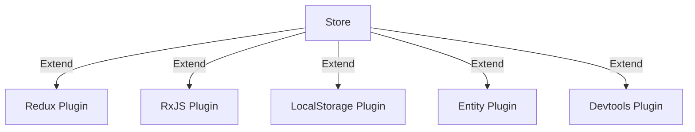

# StateBuilder


> [!WARNING]
>
> This library has been built for experimental purposes for my needs while building apps that need an
> agnostic state manager and a certain complexity.

[](https://www.npmjs.com/package/statebuilder)

`StateBuilder` is an agnostic state management library built on the top of SolidJS reactivity.

It's built to be an **extremely modular system**, with an API that allows you to add methods, utilities and custom
behaviors to your store in an easier way. Of course, this come with a built-in TypeScript support.

Solid already provides the primitives to build a state manager system thanks to signals and stores. What's missing is a
well-defined pattern to follow while building your application.

Thanks to `StateBuilder` you can **compose** the approach you like to handle your state. You can also use some patterns already exposed by the library.

## Table of contents

- [Architecture](#architecture)
- [Getting started](#getting-started)
- [Creating Plugins](#creating-plugins)
- [Usage in SolidJS](#usage-in-solidjs)
- [Copy-paste plugins](#copy-paste-plugins)

## Architecture

### **State container**

The state container it's a plain JavaScript object that collects all resolved store instances. Once created, every state
container will have it's own reactive scope, bound into a `Owner` from solid-js API.

### **Store definition creator**

The store creator it's the function that define the **store api** implementation, which requires you to follow a
specific signature to be complaint to `StateBuilder` API.

`StateBuilder` already have with two built-in store creators:

- defineStore
- defineSignal

Using the store definition, you can define your state business logic, which will be
**lazy evaluated** once the state is injected the first time.

### **Plugin**

Plugins are the **core** concept of `StateBuilder` composable system. They are configurable objects or
functions that override your store's signature, adding new features or modifying existing ones.

They can also be used to create mini-modules that can be reused across the app or other libraries.



## Getting started

### Installation

Install `StateBuilder` by running the following command of the following:

```bash
pnpm i statebuilder # or npm or yarn
```

### Enable compiler (Vite Only)

> [!NOTE]
>
> The statebuilder plugin is optional. This means that all the core features works right out of the
> box without a custom build step

If you're using Vite with SolidJS, you can use the `statebuilder` custom plugin, which provide debug and custom features through babel transforms.

- `dev`: Enable dev mode
- `autoKey`: Allows to name your stores automatically, based on the constant name.

```ts
import { defineConfig } from 'vite';
import { statebuilder } from 'statebuilder/compiler';

export default defineConfig({
  // your vite config
  plugins: [
    statebuilder({
      autoKey: true,
      dev: true,
      filterStores: [
        // define your custom store name
      ],
    }),
  ],
});
```

### Defining the store

Define the store state through the definition creator function, such as `defineStore` or `defineSignal`.
Those utilities wrap under the hood the `createSignal` and `createStore` primitives of Solid 2, but they will be lazy
initialized once the state is injected the first time.

```ts
// count.ts
import { defineSignal } from 'statebuilder';
import { createEffect } from 'solid-js';

const CountStore = defineSignal(() => 0)
  .extend((state) => ({
    increment: () => state.set((prev) => prev + 1),
    decrement: () => state.set((prev) => prev - 1),
  }))
  .extend((state) => {
    createEffect(
      () => state(),
      (count) => console.log('on state change', count),
    );
  });
```

Note that first argument is an arrow function that defines the initial value of the state.
Next, you can extend your store definition with the `.extend()` method, which is typesafe and chainable, allowing
you to use multiple plugin at once.

### Creating the `Store container`

The state can be injected through the `Container`. Each container collects stores as singletons, so once it is mounted,
the same instance of the store will be shared across it's boundaries.

```ts
// container.ts
import { Container } from 'statebuilder';
import { createRoot } from 'solid-js';

export const stateContainer = createRoot(() => Container.create());

const count = stateContainer.get(CountStore);

count(); // get the state accessor

count.set((count) => count + 1); // set the state manually

count(); // still the old value: Solid applies a write on the next flush

count.peek(); // the value with the writes that are not flushed yet

// The returned state will inherit all properties returned by the .extend() method 😁

count.increment(); // increment;

count.decrement(); // decrement;
```

> [!WARNING]
>
> Currently the most safe way to create a Container in solid-js is using context, in order to fully support
> SSR mode and avoid global state pollution.
>
> [Read more about solid-js integration](#usage-in-solidjs)

## Creating plugins

As already said in the [Architecture](#architecture) paragraph, `StateBuilder` core is powered by a pluggable system.

Plugins can be defined in two ways:

- Through a function that extends the store object
- Through a `Plugin` configuration object

The first recommendation is to split your store extension in plugins where needed, for example
when you have to reuse some business logic, and prefers the `createPlugin` API when you create generic plugins (
e.g. `LocalStoragePlugin`), in order to simplify the TS typings.

### Defining plugins through simple functions

```ts
const CountStore = defineSignal(() =>
  Number(localStorage.getItem('count') ?? 0),
).extend((state, context) => {
  context.onSet((count) => localStorage.setItem('count', String(count)));

  return {
    increment: () => state.set((prev) => prev + 1),
    decrement: () => state.set((prev) => prev - 1),
  };
});
```

### Splitting plugins with `createPlugin`

In the plugin created earlier, we could split the logic into two different plugins:

- A plugin which updates the localStorage on state change
- A plugin which augments the state with the state methods

```ts
import { createPlugin } from 'statebuilder';

const withLocalStorage = (key: string) =>
  createPlugin(
    (state, context) => {
      // Called once, when the store is created
      context.onSet((value) =>
        localStorage.setItem(key, JSON.stringify(value)),
      );
    },
    { name: 'withLocalStorage' },
  );

const CountStore = defineSignal(() => 0)
  .extend(withLocalStorage('count'))
  .extend((state) => {
    return {
      increment: () => state.set((prev) => prev + 1),
      decrement: () => state.set((prev) => prev - 1),
    };
  });
```

A plugin runs while the store is created, inside a Solid owner. Solid 2 does not allow a write there, so give the
store its first value in the definition, and write from event handlers, effects and `onSet` listeners.

### Reacting to writes with `onSet`

The plugin context has `onSet`, which runs synchronously after every write to the store, also when a plugin overrides
`set`. It receives the state after the write and a `meta` object. Use the value it receives instead of reading the
store again: until the next flush the store still returns the old state. For a store the value is a plain snapshot. It returns an unsubscribe function, and the listener is removed when the store is disposed.

```ts
const withLogger = createPlugin(
  (store, context) => {
    context.onSet((value, meta) => {
      console.log(meta.action?.name ?? 'set', value);
    });
  },
  { name: 'withLogger' },
);
```

`meta.action` is the innermost action running on this store when the write happened. A plugin marks its own writes
with `context.runInAction({ name, args }, fn)`: every write `fn` does synchronously carries that action.

### Example with reducer

```ts
import { createPlugin } from 'statebuilder';

interface StoreWithReducer<T, Action> {
  dispatch(action: Action): void;
}

function reducerPlugin<T extends StoreValue, R>(
  store: Store<T>,
  reducer: (state: T, action: R) => T,
): StoreWithReducer<T, R> {
  return {
    dispatch(action: R) {
      store.set((prevState) => reducer(prevState, action));
    },
  };
}

export const withReducer = createPlugin(reducerPlugin, { name: 'withReducer' });
```

In the example above, we get the state context, a reducer and we return a new object with a dispatch function that will
update the store thanks to the `.set()` method.

Here is an example of what we have created.

```tsx
import { defineStore, useStore } from 'statebuilder';

type Increment = { type: 'increment'; payload: number };

type Decrement = { type: 'decrement'; payload: number };

type AppActions = Increment | Decrement;

type AppState = {
  counter: number;
};

function appReducer(state: AppState, action: AppActions) {
  switch (action.type) {
    case 'increment':
      return { ...state, counter: state.counter + action.payload };
    case 'decrement':
      return { ...state, counter: state.counter - action.payload };
    default:
      return state;
  }
}

const AppState = defineStore<AppState>(() => ({ counter: 0 })).extend(
  (context) => withReducer(context, appReducer),
);

function Counter() {
  const { get: state, dispatch } = useStore(AppState);

  return (
    <>
      <h1>Count: {state.counter}</h1>
      <button onClick={() => dispatch({ type: 'increment', payload: 1 })}>
        Increment
      </button>
      <button onClick={() => dispatch({ type: 'decrement', payload: 1 })}>
        Increment
      </button>
    </>
  );
}
```

## Reading and writing with Solid 2

`statebuilder` 0.9 requires `solid-js` 2. Three rules of Solid 2 shape the API.

**A write is applied on the next flush.** `store()` and `store.get` return the old state until then. `store.peek()`
returns the state with the pending writes, without tracking. Use it inside actions and handlers that need what was
just written.

```ts
count.set(5);
count(); // 0
count.peek(); // 5
flush(); // from 'solid-js'. Solid also flushes by itself on the next microtask
count(); // 5
```

**`defineStore` takes a draft.** Mutate the draft, or return the next state. Returning a state replaces the current
one: missing keys are removed and nested objects that exist on both sides keep their identity. Returning an earlier
`peek()` restores it.

```ts
frame.set((state) => {
  state.padding = 32;
});

const before = frame.peek();
frame.set((state) => ({ ...state, padding: 0 }));
frame.set(() => before); // back to 32
```

**No write inside an owned scope.** Solid throws when a signal or store is written in a component body, a memo or the
tracking half of an effect. Write from event handlers, from the second function of `createEffect`, and from `onSet`
or `onAction` listeners.

`defineAsync(() => fetchUser())` creates a store from an async source. Reading it before the first value suspends the
closest `<Loading>`. It has `set`, `refetch()` and `peek()`, and `isPending(() => store())` tells when a new value is
on its way.

## Usage in SolidJS

Before using `statebuilder` on SolidJS, it's recommended to mount the `StoreProvider` to your app, ideally at the root.
This is needed to fix an issue with node and SSR while using global state managers.

https://vuejs.org/guide/scaling-up/ssr.html#cross-request-state-pollution

The `StoreProvider` will manage all lifecycles and instances of your store. It act like a `Container`;

```tsx
import { StoreProvider } from 'statebuilder';

// Put in your root tree
<StoreProvider>
  <App />
</StoreProvider>;
```

Once your store definition is ready, you can inject the store in your components by using the `useStore` helper.

```tsx
import { useStore } from 'statebuilder';
import { CountStore } from './count';

function Counter() {
  const count = useStore(CountStore);

  return (
    <>
      <h1>Count: {count()}</h1>
      <button onClick={() => count.increment()}>Increment</button>
    </>
  );
}
```

### Scoping stores with nested providers

A store lives in the root `StoreProvider` by default, so every component reading it gets the same instance.
To give a part of the tree its own instance, list the definition in the `provide` prop of a nested `StoreProvider`.

```tsx
<StoreProvider>
  <StoreProvider provide={[EditorStore, CanvasStore]}>
    <Editor />
  </StoreProvider>
</StoreProvider>
```

`useStore(def)` walks up from the closest provider and uses the first one that provides `def`, or the root when none
does. The result does not depend on which component asks first. A provided store is created inside its provider, so it
can read any Solid context placed above that provider, and it is disposed with it. `provide` is read once.

## Built-in plugins

// TODO

- [statebuilder/actions](packages/state/src/plugins/actions.ts): named actions with `onAction` listeners
- [statebuilder/asyncAction](packages/state/src/plugins/asyncAction.ts): asynchronous actions handler with promise and
  observables
- [statebuilder/commands](packages/state/src/plugins/commands/): commands declared as a type, with handlers attached
  through `hold`
- [statebuilder/devtools](packages/state/src/plugins/devtools/): Redux DevTools integration, `withDevtools({ name })`
- [statebuilder/reducer](packages/state/src/plugins/reducer/): `dispatch` with a reducer function

### Actions

```ts
import { withActions } from 'statebuilder/actions';

const FrameStore = defineStore(() => ({ padding: 64, visible: true })).extend(
  withActions((store) => ({
    setPadding(padding: number) {
      store.set((state) => {
        state.padding = padding;
      });
    },
    toggleVisibility() {
      store.set((state) => {
        state.visible = !state.visible;
      });
    },
  })),
);

const frame = useStore(FrameStore);
frame.actions.setPadding(32);
frame.actions.setPadding.silent(32); // runs without calling onAction listeners
frame.onAction('setPadding', ({ args }) => console.log(args[0]));
frame.onAction(['setPadding', 'toggleVisibility'], ({ name }) => {});
frame.onAction((event) => {}, { phase: 'before' }); // default phase is 'after'
```

Each action runs inside `untrack` and returns what the function returns. Solid applies its writes together on the next
flush. `after` listeners run when the
action returns, which for an async action is before its promise settles. Inside an action, `this` is the map of
actions, so `this.toggleVisibility()` runs as a nested action. `onAction` returns an unsubscribe function and also
unsubscribes on cleanup of the current owner. Using `withActions` again on the same definition adds to the same map.

### Commands

```ts
import { withProxyCommands } from 'statebuilder/commands';

type Commands = {
  setPadding: number;
  toggleVisibility: void;
};

const FrameStore = defineStore(() => ({ padding: 64, visible: true }))
  .extend(withProxyCommands<Commands>())
  .extend((store) => {
    store
      .hold(store.commands.setPadding, (padding, { state }) => ({
        ...state,
        padding,
      }))
      .hold(store.commands.toggleVisibility, (_, { set }) =>
        set((state) => {
          state.visible = !state.visible;
        }),
      );
  });

const frame = useStore(FrameStore);
frame.actions.setPadding(32);
frame.dispatch(frame.commands.setPadding, 32);
frame
  .watchCommand([frame.commands.setPadding])
  .subscribe((command) => console.log(command.consumerValue));
```

The `Commands` type is the contract of the store. Each key becomes a command object in `store.commands` and a function
in `store.actions`. `hold` attaches a handler to a command, and a command can have more than one handler. A handler
returns the new state or writes with `set`. Its `state` is `store.peek()`, so it includes the writes of the handlers
that ran before it.

`hold` also takes an object with one handler per command. TypeScript reports a command left without a handler.

```ts
store.hold({
  setPadding: (padding, { state }) => ({ ...state, padding }),
  toggleVisibility: (_, { set }) =>
    set((state) => {
      state.visible = !state.visible;
    }),
});
```

`watchCommand` returns an observable of the executed commands. It takes a list of commands, a regular expression on the
command name, or nothing to watch every command. Subscribers run after the handlers. Pass `{ phase: 'before' }` to run
before them.

```ts
frame
  .watchCommand([frame.commands.setPadding], { phase: 'before' })
  .subscribe((command) =>
    console.log('padding will be', command.consumerValue),
  );
```

`untrackCommand` runs the handlers and hides the commands from every `watchCommand` subscriber, across all stores.

```ts
import { untrackCommand } from 'statebuilder/commands';

untrackCommand(() => frame.actions.setPadding(16));
```

`withProxyCommands({ devtools: { storeName: 'frame' } })` connects the store to Redux DevTools, like `withDevtools`.
In development, dispatching a command of the store that has no handler logs a warning.

Use `withActions` when an action is one function. Use commands when you want to declare the contract apart from the
handlers, pass a command around as a value, or attach several handlers.

## Copy-paste plugins

The [plugin registry](registry/README.md) holds plugins that are not part of the package: you copy the file into your
app and edit it. Each one is a single file built on `createPlugin` and `onSet`, with a test.

- `withPersist`: saves the state to `localStorage` or an async storage and loads it back.
- `withHistory`: undo and redo.
- `withEntities`: `byId`, `add`, `update`, `remove` and `upsert` for a list of entities.
- `withOptimisticAction`: writes at once and rolls back when the request fails.
- `withSourceSwitch`: loads and saves through a local or a remote source, chosen on each call.

## Demo / Examples

// TODO

- LocalStoragePlugin: https://github.com/riccardoperra/codeimage/blob/main/apps/codeimage/src/state/plugins/local-storage.ts
- EntityPlugin: https://github.com/riccardoperra/codeimage/blob/main/apps/codeimage/src/state/plugins/withEntityPlugin.ts
- IndexedDBPlugin: https://github.com/riccardoperra/codeimage/blob/main/apps/codeimage/src/state/plugins/withIndexedDbPlugin.ts

https://github.com/riccardoperra/codeimage/blob/main/apps/codeimage/src/state/editor/frame.ts
https://github.com/riccardoperra/codeimage/blob/main/apps/codeimage/src/state/presets/presets.ts
https://github.com/riccardoperra/codeimage/blob/main/apps/codeimage/src/state/presets/bridge.ts
